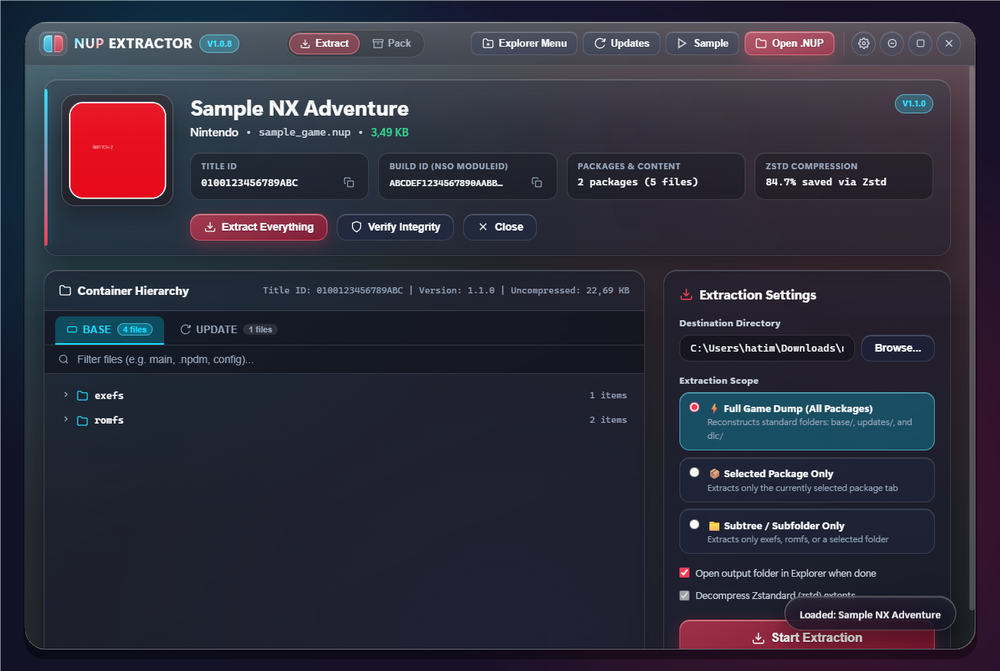
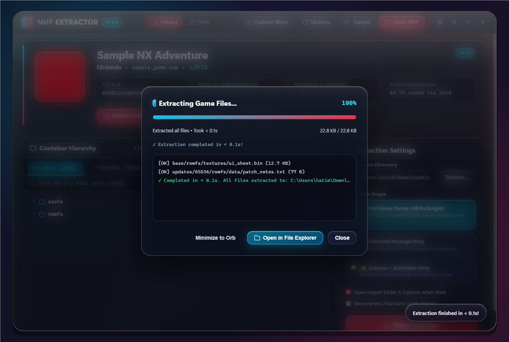

# NUP Extractor

<p align="center">
  
</p>

<p align="center">
  <strong>A fast, portable Windows desktop utility to inspect, verify, pack, and extract Nintendo Switch 1 &amp; 2 clean-room <code>.nup</code> container archives.</strong>
</p>

<p align="center">
  🌐 <strong>Official Showcase &amp; Project Website:</strong> <a href="https://spin0zai.github.io/nup-extractor/"><strong>spin0zai.github.io/nup-extractor</strong></a>
</p>

<p align="center">
  <a href="https://spin0zai.github.io/nup-extractor/"></a>
</p>

<p align="center">
  <a href="https://github.com/SPIN0ZAi/nup-extractor/releases/latest"></a>
  <a href="LICENSE"></a>
  <a href="#"></a>
  <a href="#"></a>
</p>

---

## 📸 Screenshots

<p align="center">
  
  <br>
  <em>Liquid Glass Workspace — Game icon, Title/Build IDs, Base/Update/DLC tabs, interactive file tree, and extraction controls.</em>
</p>

<br>

<p align="center">
  
  &nbsp;&nbsp;
  
</p>
<p align="center">
  <em>Left: Live progress modal with ETA countdown &amp; logs &bull; Right: Optional Floating Orb mode with edge snapping &amp; background progress ring.</em>
</p>

---

## ✨ What You Get

- **🖱️ Drag-and-Drop Batch Extraction**:
  - Drag one or multiple `.nup` files directly onto `NUP_Extractor.exe` or anywhere inside the app window to extract **Base games, Updates, and DLCs** automatically.
  - Click anywhere inside the Extract or Pack dropzones to open Windows Explorer, or use the **Try Sample Dump** button anytime to test features right out of the box.
  - Double-click registered `.nup` files in Windows Explorer to open the Container Inspector first.
- **📦 Built-In Multi-Package Packer**:
  - Switch between **Extract** and **Pack** modes to package game folders (including Base, Updates, and DLCs) back into clean `.nup` containers.
  - Choose between **Zstd Fast** (balanced), **Zstd Ultra** (maximum savings), or **RAW** (uncompressed).
- **🪟 Liquid Glass UI & Optional Floating Orb**:
  - Windows Acrylic translucent design with **Dark** and **Light** Glass themes selectable in Settings.
  - Click **Minimize to Orb** (or press `Esc`) anytime—even mid-extraction or mid-pack—to dock into a compact circular orb on your screen edge with a live progress ring.
- **🖼️ Complete Metadata & Interactive Tree Explorer**:
  - Displays game artwork, Title Name, Publisher, Version, Title ID, and Build ID with one-click copy buttons.
  - Browse Base, Update, and DLC tabs, search thousands of files instantly, inspect RAW vs Zstd compression stats, or right-click any single file to extract it individually.
- **⏱️ Live ETA, Speed & Time Spent**:
  - Real-time MB/s throughput, estimated remaining time, total elapsed time on completion, disk-space pre-checks, and instant **Cancel** or **Minimize to Orb** controls in both Extract and Pack modals.
- **🛡️ Deep Integrity Verification**:
  - Validates Superblock headers, Table of Contents SHA-256 checksums, and per-file SHA-256 hashes.
- **🔄 In-Place Auto-Updater**:
  - Checks GitHub Releases cleanly in the background or on-demand, shows clear end-user highlights, verifies SHA-256 checksums, and upgrades `NUP_Extractor.exe` in place without losing settings.

---

## 🚀 Download & Quick Start

### Option 1: Portable Windows Download (Recommended)
Download from the [GitHub Releases](https://github.com/SPIN0ZAi/nup-extractor/releases/latest) page:

1. Download **`NUP_Extractor.exe`** (or **`NUP_Extractor-windows-x64.zip`**).
2. Double-click **`NUP_Extractor.exe`** to open the app—or drag &amp; drop `.nup` files directly onto **`NUP_Extractor.exe`** to extract them automatically into `<filename>_extracted`.

*(Single ~5.5 MB executable—zero installation and zero external runtimes required!)*

### Option 2: Command-Line Usage
```powershell
# Extract all packages (Base, Updates, & DLCs) directly into a destination folder
NUP_Extractor.exe "C:\Games\MyGame.nup" "D:\Extracted\MyGame"

# Batch extract multiple .nup files next to each source file
NUP_Extractor.exe --extract "C:\Games\Base.nup" "C:\Games\Update.nup" "C:\Games\DLC.nup"
```

---

## 🛠️ Building from Source

### Prerequisites
- Windows 10 / 11 (64-bit)
- Cargo / MSVC Build Tools
- *(Optional)* [.NET 10 SDK](https://dotnet.microsoft.com/download) for running the legacy parity test suite

### Build & Test Commands
```powershell
git clone https://github.com/SPIN0ZAi/nup-extractor.git
cd nup-extractor

# Format check, linter, and all automated workspace tests
cargo fmt --all -- --check
cargo clippy --workspace --all-targets -- -D warnings
cargo test --workspace

# Optional legacy parity test suite
dotnet test legacy_dotnet/NupExtractor.slnx -c Release

# One-click release build (outputs NUP_Extractor.exe)
.\build_native.bat
```

---

## 🧪 Automated Test Coverage

| Suite | Scope |
| :--- | :--- |
| `nup-core` unit, parity & golden tests | Superblock/TOC validation, RAW & Zstd decompression, multi-package Base/Update/DLC packing, SHA-256 verification, inspect/search/tree contracts |
| `nup-host-logic` unit & golden tests | Floating orb geometry, snap-to-edge positioning, morph state machine, persisted settings round-trips |
| `nup-extractor` integration & unit tests | CLI & drag-and-drop parsing, IPC contract golden replay, embedded sample resolution, updater & SHA-256 verification |
| `legacy_dotnet` xUnit parity suite | Historical format compatibility verification |

---

## 🏛️ Project Structure

```
nup-extractor/
├── app/                           # Desktop window host, WebView2 IPC bridge, updater & CLI
├── crates/
│   ├── nup-core/                  # Clean-room NUP parser, Zstd streaming engine & packer
│   └── nup-host-logic/            # Floating orb geometry, edge snapping & morph state machine
├── static/                        # Embedded UI assets (Liquid Glass HTML/CSS/JS)
├── website/                       # GitHub Pages showcase site
├── pictures/                      # Screenshots and animations
├── tests_golden/                  # IPC, engine & orb contract fixtures
├── legacy_dotnet/                 # Archived C# reference & parity test suite
├── docs/                          # Container specification (SPEC.md, WORKFLOW.md, ORB_MODE.md)
├── .github/workflows/             # CI, GitHub Pages deploy & automated release pipelines
├── Cargo.toml                     # Workspace manifest
├── build_native.bat               # 1-Click local build & verification script
├── LICENSE                        # MIT License
└── README.md                      # Project documentation
```

---

## 👥 Contributing

- **Git Flow Guide**: See [docs/WORKFLOW.md](docs/WORKFLOW.md) for branch naming, PR checklist, and release cycles.
- **Automated CI**: Every Pull Request targeting `develop` or `main` runs `cargo fmt`, `cargo clippy`, `cargo test --workspace`, and legacy parity tests automatically before merging.

---

## 📄 License & Legal Notice

- **Software License**: Distributed under the [MIT License](LICENSE).
- **Format Specification**: NUP format specification by [a55uka](https://github.com/a55uka/nup) (MIT License).
- **Disclaimer**: This is a clean-room interoperability archive extraction utility. It does **not** contain cryptographic keys (`prod.keys`), proprietary Nintendo code, or copyrighted game files. All game dumps must be legally acquired and unencrypted before use.
