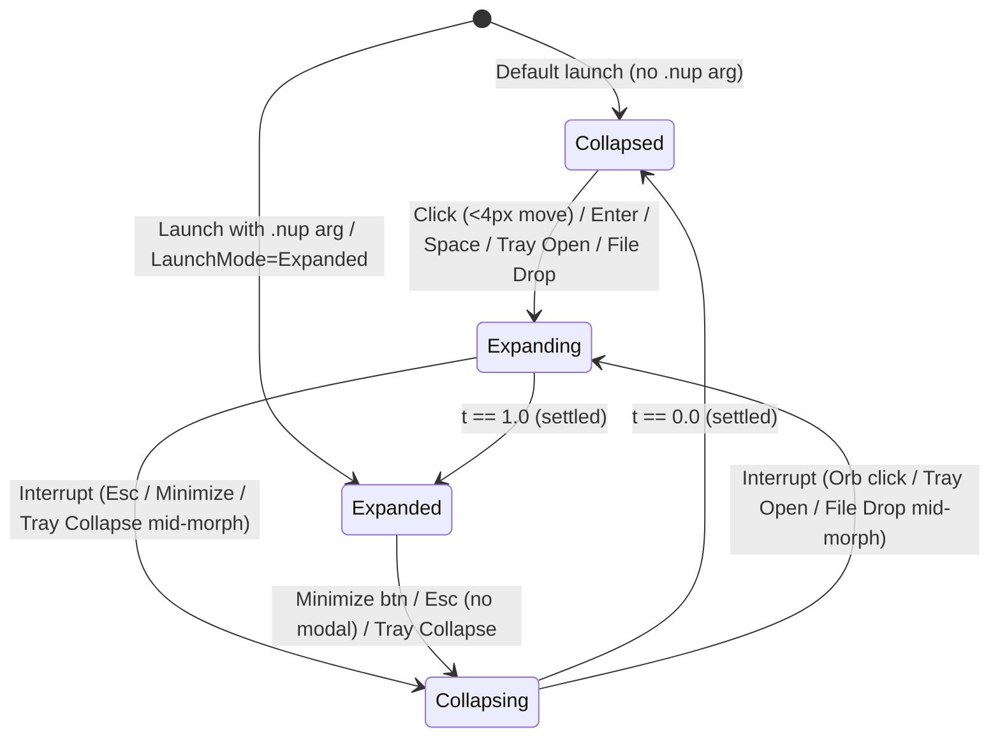

# Floating Orb Mode & Liquid Glass UI — Design Note

## 1. Chosen Windowing Approach (and Spike Results)

To host a single persistent `WebView2` session inside a borderless window that smoothly morphs between a **64 DIP circular floating orb** and a **28 px continuous-corner expanded window** with **real desktop blur**, we evaluated three approaches in a live Windows 11 (Build 26200, WebView2 `1.0.4314.35`, .NET 10) spike:

| Approach | Mechanism | Spike Result | Verdict |
| :--- | :--- | :--- | :--- |
| **Plan A** | `AllowsTransparency="True"` + `WebView2` (`DefaultBackgroundColor=Transparent`) | **Failed (Airspace bug):** `WebView2` is an `HwndHost` child HWND; under `WS_EX_LAYERED`, corners outside the CSS radius render solid black and desktop blur is unavailable. | Rejected |
| **Plan B (Chosen)** | `AllowsTransparency="False"`, `WindowStyle="None"`, `WindowChrome` (`GlassFrameThickness=-1`), `DwmExtendFrameIntoClientArea(-1)`, **Windows 11 DWM Acrylic** (`DWMWA_SYSTEMBACKDROP_TYPE = DWMSBT_TRANSIENTWINDOW`), **Windows 10 Acrylic fallback** (`SetWindowCompositionAttribute`), animated **`SetWindowRgn`** (`CreateRoundRectRgn` / `CreateEllipticRgn`), `WebView2.DefaultBackgroundColor = Transparent` | **Passed:** `DWMWA_SYSTEMBACKDROP_TYPE` returns `S_OK`; `WebView2` renders true alpha transparency over live hardware-accelerated DWM Acrylic desktop blur; `SetWindowRgn` clips both the DWM backdrop and WebView2 cleanly to an exact circle (`64x64`) and rounded `28px` expanded frame. | **Selected** |
| **Plan C** | `WebView2CompositionControl` (DirectComposition visual hosting) | Throws `FileNotFoundException` for `Microsoft.Windows.SDK.NET` unless targeting WinRT SDK projections (`net10.0-windows10.0.17763.0`), adding heavy SDK dependencies to the single-file bundle. | Not needed |

### Key Architectural Decisions
- **Single Window & Single WebView2 Session:** The orb and expanded app live inside the exact same `MainWindow` and `CoreWebView2` instance. Collapsing never destroys or reloads the DOM—loaded `.nup` containers, active package tab, search query, expanded folders, active modals, and tree scroll position remain intact.
- **Zero Swapchain-Thrash Expand & Zero-Ghost Collapse:** On **expand**, placing the host HWND once at `Union(orbRect, expandedRect)` (with a 2-frame swapchain warmup while still clipped to the orb circle) and animating `SetWindowRgn` avoids per-frame Chromium swapchain reallocation. On **collapse**, Windows 11's DWM Acrylic (`DWMSBT_TRANSIENTWINDOW`) paints across the full HWND rect even when `SetWindowRgn` shrinks, so collapse shrinks the actual HWND directly each frame via `SetWindowPos(..., SWP_NOCOPYBITS)` + `SetWindowRgn` (with `#app-layer` pinned at its expanded dimensions to prevent DOM reflow), ensuring the Acrylic backdrop shrinks pixel-for-pixel with zero lingering frosted ghost rectangle. While collapsed, `#app-layer` uses `visibility: hidden` (never `display: none`) to preserve exact scroll offsets.
- **Per-Monitor DPI v2:** Native geometry (`OrbGeometry`) operates in physical pixels paired with each monitor's `GetDpiForMonitor` scale factor, converting DIPs (`64 DIP` orb, `12 DIP` edge margin, `28 DIP` corner radius) per monitor so dragging across mixed-DPI monitors (`100%/125%/150%/200%`) works without drift or clipping.
- **Native Drag & Edge Snap:** Pointer down on the orb tracks movement against a `4 DIP` drag threshold in JS. Once crossed, C# tracks live Win32 `GetCursorPos()` directly (immune to Chromium cross-DPI coordinate skew) and snaps smoothly to the nearest work-area edge on release.
- **Windows 10 & Accessibility Fallbacks:** On Windows 10 (build `< 22621`), falls back to `SetWindowCompositionAttribute(ACCENT_ENABLE_ACRYLICBLURBEHIND)`. When Windows Transparency Effects are disabled (`EnableTransparency == 0`) or High Contrast mode is active, switches to a high-contrast solid glass-tinted theme meeting WCAG AA. When "Show animations in Windows" (`SPI_GETCLIENTAREAANIMATION`) or `prefers-reduced-motion` is disabled, swaps the ~400 ms spring morph for a quick ~140 ms fade/scale transition.

---

## 2. State Machine Diagram

Pure testable C# modules under `src_native/Orb/`:
- `OrbStateMachine.cs` — interruptible state transitions, progress timing, reduced-motion mode, and `DragTracker` (`4 px` threshold).
- `OrbGeometry.cs` — multi-monitor lookup, DPI scaling, work-area clamping, AssistiveTouch edge snapping, near-orb expansion placement, and morph interpolation.
- `OrbSettingsStore.cs` — JSON persistence in `%AppData%\NupExtractor\orb-state.json` with atomic write and corruption-safe defaults.
- `NativeBackdropHelper.cs` — DWM/Win32 interop (`DwmSetWindowAttribute`, `SetWindowCompositionAttribute`, `SetWindowRgn`, `GetDpiForMonitor`, `EnumDisplayMonitors`).
- `TrayIconManager.cs` — Win32 `Shell_NotifyIconW` tray icon with `Open` / `Collapse` / `Quit` context menu.

---

## 3. IPC Message Contract

### Page -> C# (`window.chrome.webview.postMessage`)
| Action | Payload Fields | Purpose |
| :--- | :--- | :--- |
| `orb_expand` | — | Request expand from collapsed orb (click / Enter / Space). |
| `orb_collapse` | — | Request collapse to orb (header minimize button / Esc). |
| `orb_drag_start` | — | Begin native cursor-tracked orb drag (after crossing 4 px threshold). |
| `orb_drag_move` | — | Update orb position from live Win32 `GetCursorPos()`. |
| `orb_drag_end` | — | Finish drag, snap orb to nearest monitor work-area edge, persist state. |
| `window_drag_start` | — | Begin dragging expanded window from header bar. |
| `window_toggle_maximize` | — | Toggle maximize/restore in expanded mode. |
| `window_close` | — | Exit application cleanly (header X button). |
| `orb_file_drop` | `AdditionalObjects` (`CoreWebView2File[]`) | File dropped onto orb or dropzone; expands if collapsed and loads `.nup`. |
| `get_orb_settings` | `id` | Fetch persisted orb settings & system appearance flags. |
| `update_orb_settings` | `id`, `launchMode`, `theme` | Persist user launch mode & Liquid Glass theme preference. |
| `task_progress_update` | `task`, `state`, `percent` | Mirror background task status (`extract`/`verify`/`pack`) for tray tooltip & native state. |

### C# -> Page (`CoreWebView2.PostWebMessageAsJson`)
| Type | Payload Fields | Purpose |
| :--- | :--- | :--- |
| `morph_frame` | `state`, `progress`, `radiusPx`, `width`, `height`, `expandedWidth`, `expandedHeight`, `reducedMotion`, `edge` | Frame-synchronized morph progress and shell geometry. |
| `system_appearance` | `reducedMotion`, `highContrast`, `transparencyEnabled` | Live OS accessibility & transparency state. |
| `orb_settings_result` | `id`, `success`, `settings`, `appearance` | Current settings payload for UI initialization & settings modal. |
| `load_dropped_file` | `filePath` | Instructs frontend to load a `.nup` file dropped onto the orb/window. |

---

## 4. Known Limitations

1. **No External DWM Drop Shadow under `SetWindowRgn`:** Applying a custom GDI window region (`SetWindowRgn`) disables DWM's default rectangular window shadow. Depth separation over busy desktops is provided instead via a crisp inner-bevel + luminous rim light + dark hairline edge inside the glass surface.
2. **1-Bit Region Edge Clipping:** `CreateRoundRectRgn` clips on whole physical pixels. At 100% DPI (`1x`), very tight circular curves show subtle 1 px stepping on the outer mask; our inner anti-aliased CSS rim light masks this visually, and at 125%–200% DPI it is virtually imperceptible.
3. **SVG Refraction Performance Scope:** The Liquid Glass `feTurbulence` + `feDisplacementMap` refraction filter is intentionally scoped only to small static/interactive elements (the 64 px orb lens and hero badges/primary controls) and never applied to scrolling containers like the file tree or activity log.
4. **Windows 10 Acrylic:** On Windows 10 (build `< 22621`), `DWMWA_SYSTEMBACKDROP_TYPE` is unavailable, so the app uses the undocumented `SetWindowCompositionAttribute` Acrylic blur behind and degrades gracefully to translucent dark glass if unavailable.
